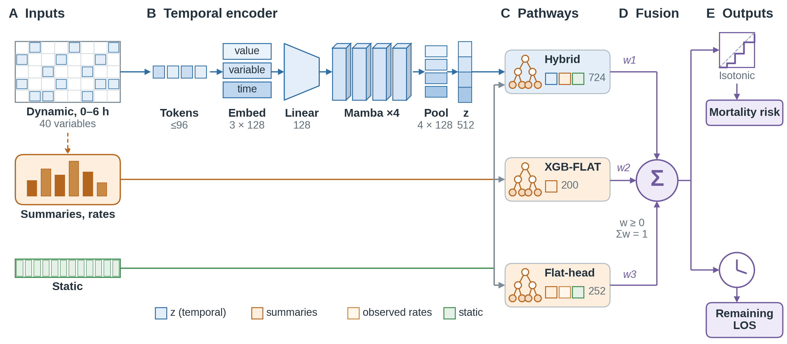
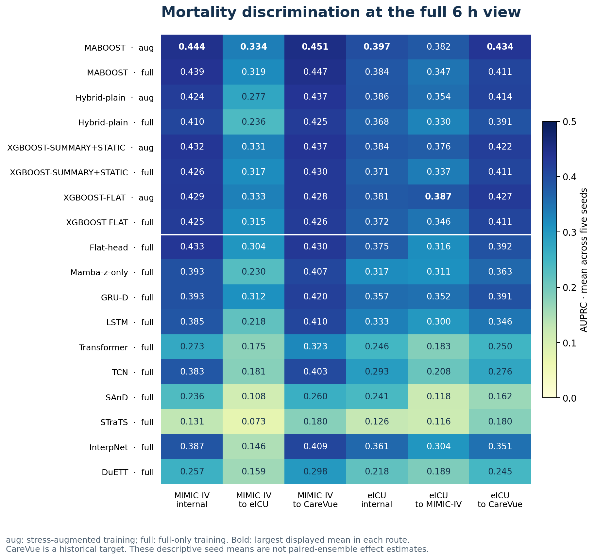
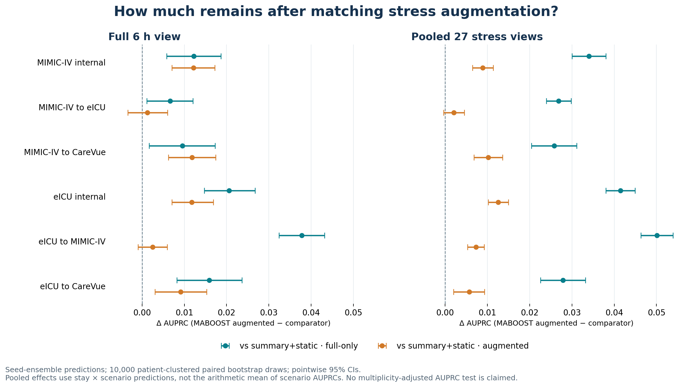
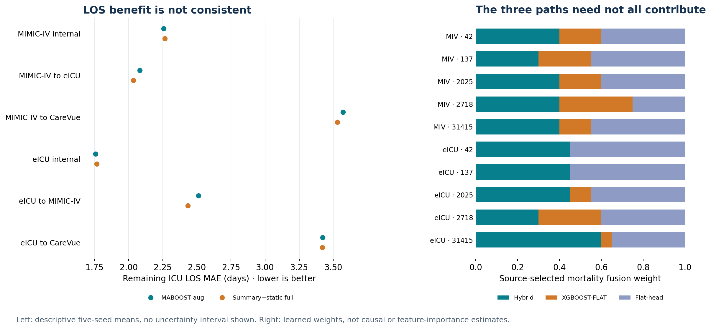
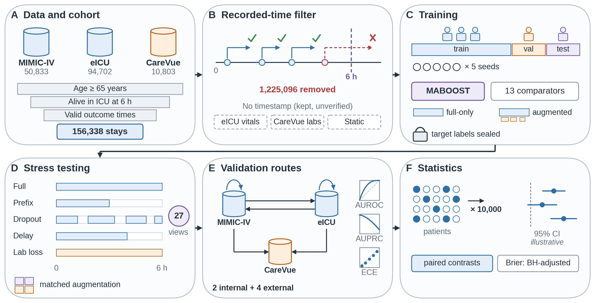

# MABOOST: a fixed-6-hour ICU benchmark

**Temporal–tabular learning under observation stress and cross-dataset shift.**

MABOOST combines a Mamba temporal encoder, gradient-boosted tabular predictors
and source-selected fusion. It predicts **death during the same ICU stay after
6 hours** and **remaining ICU length of stay (LOS)** in adults aged 65 and older.
Every prediction is anchored 6 hours after ICU admission, among stays alive and
still in the ICU at that time. The benchmark asks whether performance survives
reduced observation availability and transfer to another dataset without
target-domain tuning.

This repository contains the code to reproduce the benchmark from the source
datasets and the aggregate results of the author run (**correction10**: 180
jobs, 5 seeds, 28 scenarios, 156,338 eligible stays in three datasets). These are
research results, not a clinically validated system.



The encoder reads values, observation masks and time gaps and produces a
512-dimensional embedding (z). The Hybrid path combines z with 200 temporal
summaries and 12 static covariates. XGBOOST-FLAT uses the 200 summaries; Flat-head
adds the static covariates and 40 observedness rates. Each path has mortality and
LOS heads, and the fusion weights for each outcome are selected on the source.

**Contents**

1. [Repository layout](#1-repository-layout)
2. [Requirements](#2-requirements)
3. [Installation](#3-installation)
4. [Verify the installation without clinical data](#4-verify-the-installation-without-clinical-data)
5. [Data access and placement](#5-data-access-and-placement)
6. [Full reproduction](#6-full-reproduction)
7. [Interruption and recovery](#7-interruption-and-recovery)
8. [Outputs](#8-outputs)
9. [Published results (correction10)](#9-published-results-correction10)
10. [Verify the published results and redraw the figures](#10-verify-the-published-results-and-redraw-the-figures)
11. [Benchmark design](#11-benchmark-design)
12. [Interpreting the statistics](#12-interpreting-the-statistics)
13. [Limitations](#13-limitations)
14. [Data sources](#14-data-sources)

## 1. Repository layout

| Path | Contents |
| --- | --- |
| `reproduce.py` | Single entry point for every stage (`init` … `report`, `all`, `smoke`) |
| `setup.sh`, `requirements.txt` | Pinned environment |
| `benchmark/src/` | Cohort, ETL, availability correction, training, analysis, explanation, reporting |
| `benchmark/config/` | Locked benchmark configuration (`landmark_v13.json`) and its SHA-256 |
| `benchmark/analysis_plan_v13_landmark_amendment_02.json` | Registered analysis plan |
| `benchmark/rust_analysis_kernel/` | Rust bootstrap and metric kernel, qualified against Python before use |
| `src/models/`, `src/training/` | Mamba encoder and neural comparators |
| `tests/` | Unit and regression tests (synthetic data only) |
| `tools/` | Synthetic smoke run, code manifest, figure renderer |
| `CODE_MANIFEST.json` | SHA-256 of every distributed source and configuration file |
| `published/correction10/` | Aggregate results of the author run, with `PROVENANCE.json` |
| `published/figures/` | Figures in this README: architecture and workflow schematics (`figure_1_architecture`, `figure_2_workflow`), and three result figures rendered from `published/correction10/` |

## 2. Requirements

| Item | Version or amount |
| --- | --- |
| OS | Linux x86-64 |
| Python | 3.11 |
| GPU | NVIDIA GPU with a driver compatible with CUDA 12.8 |
| CUDA toolkit | 12.8 with `nvcc` (needed to build `mamba-ssm`), plus a C/C++ compiler |
| Rust | `rustup`; the kernel pins Rust 1.85.1 and uses no external crates |
| Python packages | PyTorch 2.7.0 (cu128), mamba-ssm 2.3.1, and `requirements.txt` |
| Disk | At least 20 GB free at preflight, plus space for the raw data and caches |
| RAM | Developed on 31 GB. A resource guardian requests cleanup at 85% system RAM and stops the job at 95% (exit code 86) |
| Compute | The 180 training jobs took about 110 cumulative wall hours on one GPU in the author run, excluding ETL and analysis |

## 3. Installation

```bash
git clone https://github.com/quangtrinh25/maboost-6h-benchmark.git
cd maboost-6h-benchmark
bash setup.sh                 # creates .venv, installs pinned packages and Rust 1.85.1
source .venv/bin/activate
python -B reproduce.py check  # verifies CODE_MANIFEST.json and imports
```

`setup.sh` installs PyTorch 2.7.0 from the CUDA 12.8 wheel index, the packages
in `requirements.txt`, and mamba-ssm 2.3.1. It downloads no clinical data. An
existing environment with the same versions can be used instead. `check` fails
if any distributed file differs from `CODE_MANIFEST.json`.

Record the Git commit, GPU, driver, CUDA and compiler versions with your run.

## 4. Verify the installation without clinical data

```bash
python -B -m unittest discover -s tests -v   # 38 tests
python -B reproduce.py matrix                # lists the 180 registered jobs
python -B reproduce.py smoke                 # synthetic end-to-end run
```

- The tests use synthetic arrays and synthetic raw-table fixtures for all
  three source formats. They include the stage-2 row-alignment regression test
  (`tests/test_embedding_alignment.py`, see [section 9.1](#91-what-correction10-changed)).
- `smoke` builds an isolated temporary checkout with synthetic data. It trains
  bounded XGBOOST-FLAT and LSTM jobs, reloads the saved models, evaluates the 28
  scenarios on three routes, checks prediction and label locks, and checks that
  completed jobs are skipped on resume. It never reads `data/raw/`.

Synthetic outputs are not evidence of clinical performance.

## 5. Data access and placement

Request credentialed access on PhysioNet and accept each data use agreement:

- [MIMIC-IV 3.1](https://physionet.org/content/mimiciv/3.1/)
- [eICU Collaborative Research Database 2.0](https://physionet.org/content/eicu-crd/2.0/)
- [MIMIC-III Clinical Database CareVue subset 1.4](https://physionet.org/content/mimic3-carevue/1.4/) (the official subset, not full MIMIC-III)

Place or symlink the compressed CSV files relative to the checkout. For
MIMIC-IV, collect the needed files from `hosp/` and `icu/` into one directory.

```text
data/raw/mimiciv/
  icustays.csv.gz      admissions.csv.gz      patients.csv.gz
  chartevents.csv.gz   labevents.csv.gz       outputevents.csv.gz
data/raw/eicu/
  patient.csv.gz       vitalPeriodic.csv.gz   vitalAperiodic.csv.gz
  nurseCharting.csv.gz lab.csv.gz             respiratoryCharting.csv.gz
  intakeOutput.csv.gz
data/raw/mimic3-carevue/1.4/
  ICUSTAYS.csv.gz      ADMISSIONS.csv.gz      PATIENTS.csv.gz
  CHARTEVENTS.csv.gz   LABEVENTS.csv.gz       OUTPUTEVENTS.csv.gz
```

Keep the files as released. The ETL needs the recording or revision timestamp
columns where they exist and does not fall back to event time when a required
column is missing. `data/` is ignored by Git; never commit clinical data.

## 6. Full reproduction

One command runs every stage in order:

```bash
source .venv/bin/activate
python -B -u reproduce.py all
```

The same sequence, stage by stage:

| Step | Command | What it does | Phase report |
| ---: | --- | --- | --- |
| 1 | `python -B reproduce.py init` | Registers a new run bound to the code and configuration hashes | `benchmark/private/run_registration.json` |
| 2 | `python -B reproduce.py check` | Verifies `CODE_MANIFEST.json` and dependencies | – |
| 3 | `python -B reproduce.py build-kernel` | Builds the Rust kernel, runs its tests, checks it against Python at one and several threads | kernel qualification |
| 4 | `python -B reproduce.py preflight` | Checks GPU, disk, RAM and raw inputs | `A_PREFLIGHT` |
| 5 | `python -B -u reproduce.py etl` | Cohort, recorded-time filtering, features, labels, patient-grouped splits | `B_ETL` |
| 6 | `python -B -u reproduce.py train --resume` | Trains and evaluates the 180 jobs | `D_FULL` |
| 7 | `python -B -u reproduce.py analyze` | Seed metrics, paired patient-clustered bootstrap, permutation tests | `E_ANALYSIS` |
| 8 | `python -B -u reproduce.py explain` | Fusion contributions, SHAP, temporal occlusion | `F_EXPLAINABILITY` |
| 9 | `python -B -u reproduce.py report` | Tables and figures | `G_REPORTING` |

Each stage writes a phase report with SHA-256 provenance under
`results/benchmark/phase_reports/` and refuses to start unless its predecessor
passed. Analysis requires all 180 jobs to be complete and verified.

A fresh run trains all 180 jobs with the row-aligned stage 2. It gets its own run
identity and does not use the author's encoders or private files. Hardware, CUDA
libraries and numerical nondeterminism can change exact values, so compare a new
run with the published results by effect size and interval, not bit for bit.

Do not run `tools/lock_code.py` after `init`. Any code or configuration change
requires a fresh checkout and a new `init`.

## 7. Interruption and recovery

Resume from the interrupted stage. Completed jobs are verified by hash and
skipped. An incomplete attempt is archived under `benchmark/superseded/` and the
job restarts from the beginning (recovery is per job, not per epoch).

```bash
# After a stop (including guardian exit 86): free RAM, make sure no runner is alive, then
python -B -u reproduce.py train --resume
python -B -u reproduce.py analyze
python -B -u reproduce.py explain
python -B -u reproduce.py report
```

To train a single registered job:

```bash
python -B -u reproduce.py train --job mimic_iv__xgboost_flat__full_only__seed42
```

Per-job logs are in `results/benchmark/logs/training/<job-id>.log`. A restarted
analysis reuses its verified bootstrap shards. Do not rerun a completed upstream
stage only to retry a later one: rewriting its report invalidates downstream
provenance.

## 8. Outputs

| Location | Contents | Shareable |
| --- | --- | --- |
| `benchmark/private/processed/` | Feature arrays, sealed labels, raw-input hashes, ETL audits | No (patient level) |
| `benchmark/private/jobs/` | Models, source choices, completion locks, per-stay predictions | No (patient level) |
| `benchmark/private/` | Run registration, splits, kernel qualification, bootstrap state | No |
| `results/benchmark/canonical/` | Seed metrics, aggregates, paired contrasts, cohort flow, subgroups | Aggregates only |
| `results/benchmark/explainability/` | Fusion, SHAP and occlusion summaries | Aggregates only |
| `results/benchmark/tables/`, `figures/` | Report tables and figures | After small-cell review |
| `results/benchmark/phase_reports/` | Stage status and SHA-256 provenance | Yes |

The PhysioNet data use agreements forbid sharing patient-level data. Before
publishing a table or figure, suppress cells with fewer than 11 stays.

## 9. Published results (correction10)

`published/correction10/` holds the aggregate results of the author run. Each
file was copied after verification against the run's SHA-256 sidecars.

| Folder | Files |
| --- | --- |
| `canonical/` | `aggregate_metrics.csv` (seed mean and SD per model × regime × route × scenario), `per_seed_metrics.csv`, `primary_contrasts.csv` (paired bootstrap contrasts), `seed_level_bootstrap_forest.csv`, `cohort_flow.csv`, `cohort_characteristics.csv`, `measurement_shift_smd.csv`, `subgroups.csv`, `inference_counts.csv`, `model_registry.csv`, `canonical_analysis_report.json` |
| `tables/` | Report tables 1–8, supplements, `reliability_bins.csv` |
| `explainability/` | Fusion pathway contributions, SHAP importance (aggregate and per seed), temporal occlusion, `explainability_report.json` |
| `etl/` | `availability_filter_counts.csv`: records kept and removed by the recorded-time rule, per table |
| `figures/` | Report figures 1, 2, 3, 5 and 6 (PDF; figure 5 also PNG) |
| `PROVENANCE.json` | Run identity, phase-report hashes, and per-file SHA-256, row count, source and transformation |

Only aggregate statistics are published: no identifiers, per-stay predictions,
checkpoints or raw data. Calibration bins with fewer than 11 stays are blanked
in `reliability_bins.csv` (flag column `suppressed_lt_11_stays`). Report figure 4
(reliability) is withheld because it plots those bins.

### 9.1 What correction10 changed

The earlier run (correction09) fitted stage 2 on training-set embeddings
extracted through the shuffled training loader, while the labels and tabular
features stayed in index order. The training rows of stage 2 were therefore
misaligned. Validation and test embeddings were extracted in order and were not
affected.

The fix is in `benchmark/src/v13_training.py`. Every inference loader keeps
index order (`make_loaders(..., shuffle_train=False)`), and stage 2 raises an
error if the loader labels differ from the index-ordered labels.
`tests/test_embedding_alignment.py` fails on the old code and passes on the fix.

Fifty jobs used Mamba embeddings in stage 2 (Mamba-z-only, Hybrid-plain and
MABOOST; both sources × five seeds). For the author run, these 50 jobs kept their
correction09 encoders, whose training was not affected, and refitted stage 2,
fusion, calibration and inference. The other 130 jobs were imported after hash
verification. Analysis, explanation and reporting were rerun. A fresh run from
this repository trains all 180 jobs with the fixed code.

### 9.2 Cohorts

| Dataset | Eligible ICU stays | Patients | Deaths after 6 h | Event rate | Role |
| --- | ---: | ---: | ---: | ---: | --- |
| MIMIC-IV 3.1 | 50,833 | 35,841 | 4,508 | 8.87% | Source and external target |
| eICU 2.0 | 94,702 | 70,158 | 5,980 | 6.31% | Source and external target |
| MIMIC-III CareVue 1.4 | 10,803 | 8,337 | 1,497 | 13.86% | Historical external target only |

Patient counts are within each dataset. `canonical/cohort_flow.csv` lists each
exclusion step.

### 9.3 Mortality at the full 6-hour view

Means over five seeds, not an ensemble. MABOOST uses stress-augmented training;
the comparator is XGBOOST-SUMMARY+STATIC with full-only training.

| Source → evaluation cohort | MABOOST AUROC | MABOOST AUPRC | Comparator AUPRC | MABOOST Brier ↓ |
| --- | ---: | ---: | ---: | ---: |
| MIMIC-IV → internal test | 0.862 | 0.444 | 0.426 | 0.062 |
| MIMIC-IV → eICU | 0.830 | 0.334 | 0.317 | 0.050 |
| MIMIC-IV → CareVue | 0.814 | 0.451 | 0.430 | 0.098 |
| eICU → internal test | 0.866 | 0.397 | 0.371 | 0.047 |
| eICU → MIMIC-IV | 0.820 | 0.382 | 0.337 | 0.067 |
| eICU → CareVue | 0.795 | 0.434 | 0.411 | 0.103 |



### 9.4 Paired contrasts

MABOOST (augmented) minus XGBOOST-SUMMARY+STATIC, AUPRC. Differences use
seed-ensemble predictions per stay and 10,000 patient-clustered bootstrap draws
(pointwise 95% CI).

| Route | vs full-only comparator, full view | vs augmented comparator, full view | vs augmented comparator, pooled stress |
| --- | --- | --- | --- |
| MIMIC-IV internal | +0.012 (0.006, 0.019) | +0.012 (0.007, 0.017) | +0.009 (0.006, 0.011) |
| MIMIC-IV → eICU | +0.007 (0.001, 0.012) | +0.001 (−0.003, 0.006) | +0.002 (−0.000, 0.005) |
| MIMIC-IV → CareVue | +0.010 (0.002, 0.017) | +0.012 (0.006, 0.017) | +0.010 (0.007, 0.014) |
| eICU internal | +0.021 (0.015, 0.027) | +0.012 (0.007, 0.017) | +0.013 (0.010, 0.015) |
| eICU → MIMIC-IV | +0.038 (0.032, 0.043) | +0.002 (−0.001, 0.006) | +0.007 (0.005, 0.009) |
| eICU → CareVue | +0.016 (0.008, 0.024) | +0.009 (0.003, 0.015) | +0.006 (0.002, 0.009) |

Against the full-only comparator, all six full-view intervals exclude zero.
When the comparator receives the same stress augmentation, four of six do; the
two MIMIC-IV ↔ eICU transfers at the full view do not. Part of the primary gain
therefore comes from the training augmentation rather than the architecture.



### 9.5 LOS, ablation and fusion



- **LOS.** Mortality gains do not carry over to LOS. Mean MAE for MABOOST vs the
  full-only comparator is 2.082 vs 2.035 days (MIMIC-IV → eICU) and 2.511 vs
  2.434 days (eICU → MIMIC-IV).
- **Temporal ablation.** Mamba-z-only (XGBoost on the encoder embedding alone)
  reaches mean full-view AUROC 0.737–0.841, lower than every full-only tabular
  baseline on each route.
- **Fusion.** The XGBOOST-FLAT mortality weight is zero in two of five
  eICU-source seeds. Fusion weights are not feature-importance or causal
  estimates.
- **No universal winner.** In eICU → MIMIC-IV, augmented XGBOOST-FLAT has a higher
  mean AUPRC (0.387 vs 0.382) and AUROC (0.828 vs 0.820) than MABOOST. No paired
  contrast for that pair was registered.

## 10. Verify the published results and redraw the figures

This needs only NumPy, pandas and Matplotlib, and no clinical data.

```bash
python -B tools/render_results.py --verify-only  # checks every file against PROVENANCE.json
python -B tools/render_results.py                # redraws the three result figures in published/figures/
```

To check the hashes without the renderer:

```bash
python - <<'EOF'
import hashlib, json, pathlib
root = pathlib.Path("published/correction10")
manifest = json.loads((root / "PROVENANCE.json").read_text())
bad = [a["file"] for a in manifest["artifacts"]
       if hashlib.sha256((root / a["file"]).read_bytes()).hexdigest() != a["sha256"]]
print("all match" if not bad else f"mismatch: {bad}")
EOF
```

`PROVENANCE.json` also records the identity of the author run: the run
registration hash, the code manifest hash, and the hashes of the six phase
reports (A, B, D, E, F and G, all `pass`). The author run used an internal
checkout, so its code identity differs from this repository's
`CODE_MANIFEST.json`. A new run here gets a new identity.

## 11. Benchmark design



| Element | Specification |
| --- | --- |
| Cohort | Age ≥ 65; alive and in the ICU strictly after 6 h |
| Outcomes | Death during the same ICU stay after 6 h; remaining ICU LOS from 6 h |
| Inputs | 40 dynamic variables and 12 static covariates; at most 96 observed steps in the first 6 h |
| Recorded-time rule | Where a separate recording timestamp exists, a record is kept only if `0 ≤ event time ≤ recorded time ≤ 360 min` and enters the timeline at the ceiling of the recorded minute. Filtering precedes aggregation and truncation |
| Splits | Patient-grouped 60/20/20 train/validation/test on each source; target datasets are evaluated in full |
| Seeds | 42, 137, 2025, 2718, 31415 |
| Models | MABOOST, Hybrid-plain, Mamba-z-only, Flat-head, XGBOOST-FLAT, XGBOOST-SUMMARY+STATIC; neural comparators GRU-D, LSTM, Transformer, TCN, SAnD, STraTS, InterpNet, DuETT |
| Training regimes | Full-only for all models; stress-augmented (full view plus 6 augmentation views) for MABOOST, Hybrid-plain and both XGBoost baselines |
| Routes | Train on MIMIC-IV or eICU; evaluate on the source test split and on the other two datasets |
| Scenarios | 28 per stay: the full 6 h view and 27 stress views (early prefixes, windows, event budgets, missingness, density and timing, recency), all on the same 6 h risk set |
| Selection | Fusion weights, isotonic calibration and thresholds are chosen on source validation data; target labels are read only after predictions are locked |
| Statistics | 10,000 patient-clustered paired bootstrap draws; 10,000 sign permutations with Benjamini–Hochberg families for Brier |

## 12. Interpreting the statistics

- Seed means (`aggregate_metrics.csv`) and paired ensemble contrasts
  (`primary_contrasts.csv`) estimate different quantities. Do not subtract seed
  means to obtain a contrast.
- Pooled-stress contrasts pool stay × scenario predictions over the 27 stress
  views. They are not the mean of 27 scenario AUPRCs.
- AUROC, AUPRC and LOS intervals are pointwise and unadjusted. Only Brier has
  registered permutation tests with BH adjustment.
- The five seeds are not independent samples.

## 13. Limitations

- Recorded-time availability is not established for every source. CareVue labs,
  eICU vital tables and per-field static data have no separate recording
  timestamp. eICU lab revision time is a conservative cutoff, not proof of first
  availability.
- CareVue is a historical cohort (2001–2008).
- Baselines use a common benchmark recipe, not each original paper's tuning.
- The full 180-job workload has not been rerun from this public checkout; the
  published numbers come from the author run described in section 9.1.
- There is no prospective validation and no clinical utility assessment.

## 14. Data sources

- Johnson A, Bulgarelli L, Pollard T, et al. MIMIC-IV (version 3.1). PhysioNet.
  https://doi.org/10.13026/kpb9-mt58
- Pollard T, Johnson A, Raffa J, et al. eICU Collaborative Research Database
  (version 2.0). PhysioNet. https://doi.org/10.13026/C2WM1R
- Johnson A, Pollard T, Mark R. MIMIC-III Clinical Database CareVue subset
  (version 1.4). PhysioNet. https://doi.org/10.13026/8a4q-w170
- Goldberger A, Amaral L, Glass L, et al. PhysioBank, PhysioToolkit, and
  PhysioNet. Circulation. 2000;101(23):e215–e220.

Cite the datasets as their PhysioNet pages require.
