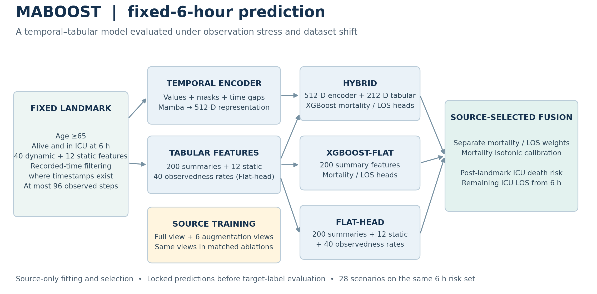
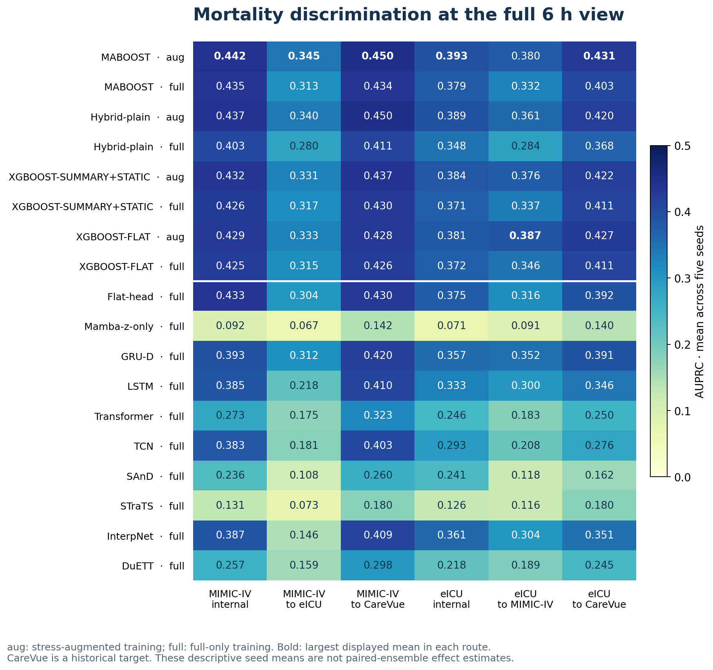
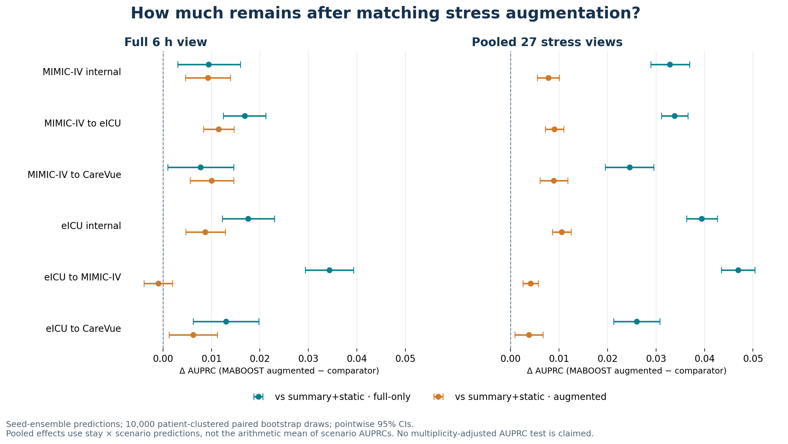
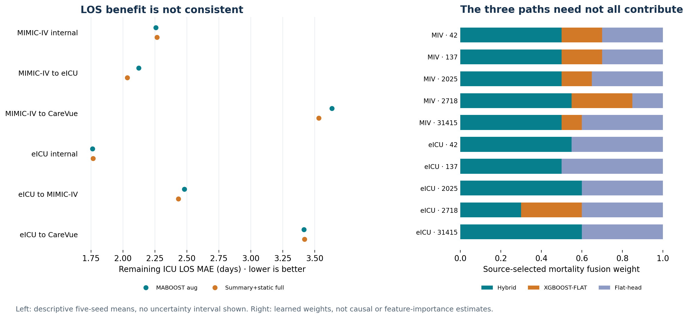

# MABOOST: a fixed-6-hour ICU benchmark

**Temporal–tabular learning under observation stress and cross-dataset shift.**

[Reproduce the benchmark](REPRODUCING.md) · [Evaluation report](EVALUATION.md) · [Aggregate results](docs/benchmark/correction09/) · [Result provenance](docs/benchmark/correction09/PROVENANCE.json)

MABOOST combines a Mamba temporal encoder, gradient-boosted tabular predictors,
and source-selected fusion to predict **death during the same ICU stay after
6 hours** and **remaining ICU length of stay** in adults aged 65 and older.
Every prediction is anchored at 6 hours after ICU admission, among stays alive
and still in the ICU at that time. The benchmark asks whether performance
survives reduced observation availability and transfer to another dataset
without target-domain tuning.

This release presents the completed **correction09 recorded-availability run**:
180 training/evaluation jobs, five seeds, 28 scenarios, and 156,338 eligible stays
across three datasets. Computation completed on 17 September 2026; artifacts were
verified on 18 September. These are research results supporting a planned
*Computer Methods and Programs in Biomedicine* manuscript, not an accepted
publication or a clinically validated system.

## Architecture

The temporal encoder processes values, observation masks, and time gaps to form
a 512-dimensional representation. The hybrid pathway combines this representation
with 200 temporal summary features and 12 static covariates. Two complementary
tabular pathways use the 200 summaries alone (**XGBOOST-FLAT**) or augment them
with static covariates and 40 observedness rates (**Flat-head**). Each pathway
has mortality and LOS heads.

Mortality fusion weights are selected on source validation data, followed by
isotonic calibration and threshold selection. LOS weights are selected separately.
Preprocessing and all model choices use source data; target labels are opened
only after predictions and source choices are locked. The benchmark does not
adapt or recalibrate models using target labels.

## Benchmark design

| Dataset | Eligible ICU stays | Patients | Mortality events | Event rate | Role |
| --- | ---: | ---: | ---: | ---: | --- |
| [MIMIC-IV 3.1](https://physionet.org/content/mimiciv/3.1/) | 50,833 | 35,841 | 4,508 | 8.87% | Development source and external target |
| [eICU 2.0](https://physionet.org/content/eicu-crd/2.0/) | 94,702 | 70,158 | 5,980 | 6.31% | Development source and external target |
| [MIMIC-III CareVue 1.4](https://physionet.org/content/mimic3-carevue/1.4/) | 10,803 | 8,337 | 1,497 | 13.86% | Historical external target only |

Counts describe the study's eligible cohorts, not the complete source databases.
Patient counts are within-dataset counts; they are not a cross-dataset deduplicated
population. CareVue uses the official subset rather than full MIMIC-III.

| Design element | Specification |
| --- | --- |
| Landmark and outcomes | Fixed 6 h; subsequent same-stay ICU death; remaining ICU LOS measured from 6 h |
| Input contract | 40 dynamic variables, 12 static covariates, at most 96 steps |
| Source partitions | Patient-grouped 60/20/20 train/validation/test |
| Seeds | 42, 137, 2025, 2718, 31415 |
| Models | 6 primary-family labels + 8 neural architecture comparators |
| Training comparison | Primary registry plus matched full-only/stress-augmented variants for MABOOST, Hybrid-plain, and both XGBoost baselines |
| Evaluation | 28 views per stay: full 6 h + 27 stress views; unchanged 6 h risk set |
| Inference | 10,000 patient-clustered paired bootstrap draws; 10,000 Brier sign permutations with configured BH families |

The six primary-family labels are MABOOST, Hybrid-plain, Mamba-z-only, Flat-head,
XGBOOST-FLAT, and XGBOOST-SUMMARY+STATIC. Neural comparators are GRU-D, LSTM,
Transformer, TCN, SAnD, STraTS, InterpNet, and DuETT. These are implementations
under a common benchmark recipe, not claims to reproduce each original paper's
best tuning.

**Recorded-time correction.** This is a post-audit methodological correction.
When a separate timestamp exists, retained records must satisfy
`0 ≤ event time ≤ recorded time ≤ 360 min`, then enter the timeline at the ceiling
of the recorded minute. Filtering precedes aggregation, derived GCS, and sequence
truncation. CareVue labs, eICU vital tables, and per-field static availability
remain unverified. eICU lab revision time provides a conservative final-version
cutoff, not proof of first-result availability. Earlier prefixes are stress views
at the same outcome landmark. **Universal prospective availability is not established.**

## Mortality results

At the full 6 h view, MABOOST has higher mean AUPRC than the full-only
summary-plus-static comparator on all six evaluation routes. The following are
**means of five seed-specific metrics**, not metrics of an ensemble.

| Training source → evaluation cohort | MABOOST AUROC | MABOOST AUPRC | Summary+static AUPRC | MABOOST Brier ↓ |
| --- | ---: | ---: | ---: | ---: |
| MIMIC-IV → internal test | 0.8611 | 0.4420 | 0.4258 | 0.0621 |
| MIMIC-IV → eICU | 0.8360 | 0.3454 | 0.3169 | 0.0504 |
| MIMIC-IV → CareVue | 0.8139 | 0.4505 | 0.4296 | 0.0983 |
| eICU → internal test | 0.8651 | 0.3932 | 0.3714 | 0.0470 |
| eICU → MIMIC-IV | 0.8200 | 0.3795 | 0.3373 | 0.0668 |
| eICU → CareVue | 0.7958 | 0.4315 | 0.4113 | 0.1031 |

MABOOST uses stress-augmented training here; the comparator uses full-only
training. The complete comparison, including augmented baselines, is shown below.

### Does the advantage remain with matched augmentation?

The primary comparison mixes model design and training augmentation. A matched
comparison makes the attribution more cautious. For MIMIC-IV → eICU, the paired
full-view AUPRC difference versus the **augmented** summary-plus-static baseline
is **+0.0115** (pointwise 95% CI **0.0084 to 0.0147**). For eICU → MIMIC-IV it is
**−0.0010** (**−0.0039 to 0.0020**), which does not establish a full-view advantage.
Under pooled stress, the corresponding differences are **+0.0091**
(**0.0072 to 0.0110**) and **+0.0042** (**0.0025 to 0.0057**).

These effects use **per-stay seed-ensemble predictions** and patient-clustered
bootstrap intervals. They must not be substituted for differences between the
seed means above. Pooled-stress effects pool stay × scenario predictions across
27 views; they are not the average of 27 scenario-level AUPRCs. AUROC/AUPRC/LOS
intervals are pointwise. Only Brier has the registered permutation/BH tests;
the [evaluation report](EVALUATION.md#statistical-interpretation) explains their
patient-weighting distinction.

**The evidence does not support universal superiority.** In eICU → MIMIC-IV,
augmented XGBOOST-FLAT has full-view AUPRC **0.3865**, above MABOOST's **0.3795**.
Its AUROC is also higher (**0.8280 vs 0.8200**). No paired contrast against
augmented XGBOOST-FLAT was registered, so this is a descriptive comparison.

## LOS, ablations, and interpretation

Mortality improvements do not translate to consistent LOS improvements. For
MIMIC-IV → eICU, mean LOS MAE is **2.123 days** for MABOOST versus **2.035 days**
for full-only summary-plus-static; for eICU → MIMIC-IV it is **2.480 vs 2.434 days**.
The LOS endpoint is remaining ICU duration, not a validated discharge policy.

The Mamba-z-only ablation has mean full-view AUROC **0.502–0.525** across routes.
Thus the benchmark does not establish a strong standalone temporal representation.
The XGBOOST-FLAT mortality fusion weight is zero in **four of five eICU-source
seeds**. A nonzero hybrid weight alone does not prove the temporal embedding adds
value beyond tabular predictors. SHAP and occlusion summaries are descriptive
model diagnostics, not causal explanations or clinical recommendations.

## Reproducibility and evidence

The [reproduction guide](REPRODUCING.md) contains environment setup, governed-data
layout, the full run, stage-by-stage commands, interruption recovery, a synthetic
walkthrough, and instructions to redraw these figures without clinical data.

The published [aggregate CSVs](docs/benchmark/correction09/) preserve the verified
author results; their hashes and origins are recorded in
[PROVENANCE.json](docs/benchmark/correction09/PROVENANCE.json). The public code
implements the recorded-time policy for a **new independent run**, without the
author's private audit files. Its identity is intentionally distinct from the
completed author run. The complete 180-job workload has not been rerun in this
portable checkout, and bitwise equivalence across hardware is not asserted.

The repository contains code, documentation, aggregate results, and figures.
Raw clinical data, patient-level predictions, fitted models, and the manuscript
are not distributed. Access to the source datasets must be obtained separately.

## Scope for the planned manuscript

The supported contribution is an auditable fixed-landmark benchmark and a
temporal–tabular system with improved mortality performance under several
observation-stress and transfer comparisons. The matched baselines, mixed LOS
results, weak temporal-only ablation, historical CareVue setting, and incomplete
availability evidence bound that claim. Prospective validation, clinical utility,
and independently optimized baseline comparisons remain future work.

Dataset references: [MIMIC-IV 3.1](https://doi.org/10.13026/kpb9-mt58),
[eICU 2.0](https://physionet.org/content/eicu-crd/2.0/), and
[CareVue 1.4](https://doi.org/10.13026/8a4q-w170). Cite the underlying resources
according to their source pages. No manuscript DOI is assigned in this release.
